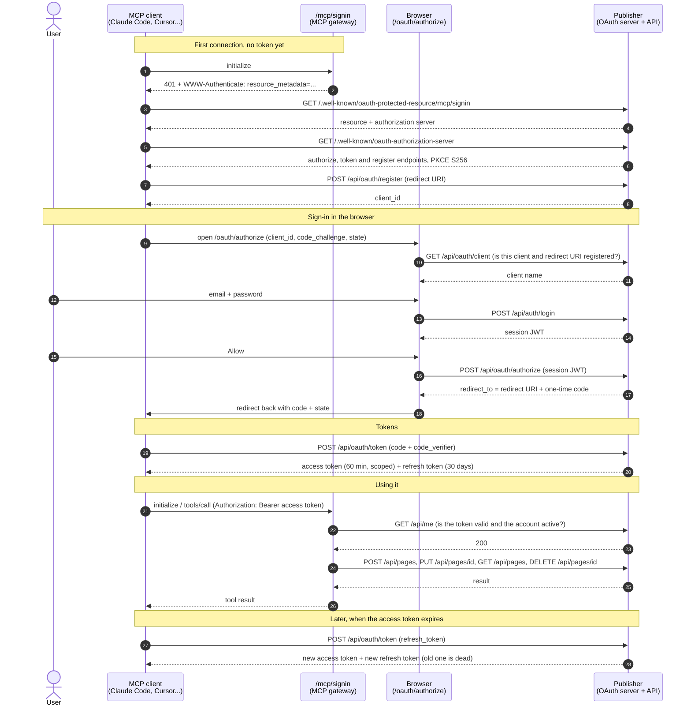

# OAuth sign-in for the hosted MCP endpoint

MCP clients that implement the [MCP authorization spec](https://modelcontextprotocol.io/specification/draft/basic/authorization) (OAuth 2.1 with PKCE and dynamic client registration) can connect to pushpage with a browser sign-in instead of a copied API key.

| Endpoint | Behavior |
|----------|----------|
| `https://pushpage.link/mcp` | Unchanged: guest mode without a key, or `X-Api-Key` / `Authorization: Bearer pp_...` with one. |
| `https://pushpage.link/mcp-guest` | Always a guest, whatever the client sends: any key or token is dropped. The URL to give people for trying it with no account. |
| `https://pushpage.link/mcp/signin` | The same MCP server, but only for signed-in callers. Without a valid credential it answers `401` with a `WWW-Authenticate` header pointing at the discovery document, which is what makes the client open the browser. |

Guest mode never answers `401`, so a client can only discover the sign-in flow through the second URL.

## Flow

**Where each URL fits:** `/mcp` (guests or an API key) and `/mcp-guest` (always keyless) skip all of this. Only `/mcp/signin` starts the flow above. An OAuth token can only publish, list and delete pages; admin, API-key management and issuing more tokens return `403`.

The same flow in words:

1. The client calls `/mcp/signin`, gets `401` with `resource_metadata="…/.well-known/oauth-protected-resource/mcp/signin"`.
2. It reads the protected-resource metadata, then the authorization-server metadata at `/.well-known/oauth-authorization-server`.
3. It registers itself at `POST /api/oauth/register` (RFC 7591) and receives a `client_id`.
4. It opens `/oauth/authorize?...&code_challenge=…&code_challenge_method=S256` in the browser. The page checks the client and redirect URI, signs the user in with their existing email and password (or reuses the dashboard session), and asks them to allow the app.
5. The browser returns to the client's redirect URI with a one-time `code`; the client exchanges it at `POST /api/oauth/token` (with the PKCE `code_verifier`) for an access token and a refresh token.
6. The client calls `/mcp/signin` with `Authorization: Bearer <access token>`.

## Design

- **The publisher is the authorization server.** Identity is the existing email/password account; there is no separate user store. Self-hosted instances get it with no extra service: the issuer is `APP_SERVER_URL`.
- **Public clients only**, no client secret. PKCE with `S256` is required. Redirect URIs must match a registered one exactly; registration accepts `https`, `http` on localhost/127.0.0.1/[::1], and custom app schemes, never `javascript:`/`data:`/`file:` or a fragment.
- **Access tokens** are the same signed JWTs as dashboard sessions, with a `scope` claim and a short life (`OAUTH_ACCESS_TOKEN_MINUTES`, default 60). **Refresh tokens** are random, stored hashed, rotate on every use (the old one stops working) and last `OAUTH_REFRESH_TOKEN_DAYS` (default 30). Authorization codes live 2 minutes and work once.
- **Scopes:** `pages:publish` (`POST /api/pages` and `PUT /api/pages/{id}`, replacing the content of an existing page), `pages:read` (`GET /api/pages`), `pages:delete` (`DELETE /api/pages/{id}`). A client that asks for none gets all three. A token can also read `GET /api/me`. **Everything else is refused with `403`**: admin endpoints, API key management and `/api/oauth/authorize`, so a leaked token cannot mint keys or more tokens.
- **Grants and revocation:** each app a user allows gets one *grant* (re-authorizing the same app reuses it, so reconnecting does not pile up entries). Every access token names its grant, and the API checks that it still exists. The user sees their grants under **Account → Connected apps** in the dashboard and can **Remove** one: it loses access **immediately** (its access tokens stop working even though they have not expired, and its refresh tokens are deleted), other apps and API keys are untouched, and the app can ask to be connected again. A password change or reset also invalidates every access and refresh token, and so does deactivating the account.
- **API keys and guest mode are unaffected.** The MCP server presents `pp_` keys in `X-Api-Key` and OAuth tokens (JWTs) in `Authorization` to the API.

## Endpoints

All under `/api` except the discovery documents and the consent page, which nginx serves at the site root.

| Method | Path | Auth |
|--------|------|------|
| `GET` | `/.well-known/oauth-protected-resource/mcp/signin` (→ `/api/oauth/protected-resource`) | none |
| `GET` | `/.well-known/oauth-authorization-server` (→ `/api/oauth/metadata`) | none |
| `POST` | `/api/oauth/register` | none, rate-limited per IP (`RATE_LIMIT_SIGNUP_RPM`) |
| `GET` | `/oauth/authorize` | the consent page (static HTML, `noindex`) |
| `GET` | `/api/oauth/client?client_id&redirect_uri` | none; returns the client name for the consent page |
| `POST` | `/api/oauth/authorize` | signed-in session (JWT); an API key or OAuth token gets `403` |
| `GET` | `/api/me/connected-apps` | signed-in session (JWT); an API key or OAuth token gets `403` |
| `DELETE` | `/api/me/connected-apps/{id}` | signed-in session (JWT); `404` if the grant is not yours |
| `POST` | `/api/oauth/token` | none (`authorization_code` and `refresh_token` grants, form-encoded) |

Errors from the token and registration endpoints follow RFC 6749 / 7591: `{"error": "...", "error_description": "..."}`.

## Storage

Migration `V1004__oauth_authorization_server.sql` adds `oauth_clients`, `oauth_grants`, `oauth_codes` and `oauth_refresh_tokens` (codes and refresh tokens as SHA-256 hashes). Expired codes and refresh tokens are removed hourly. Registered clients are kept (they are small, and clients cache their `client_id`).
